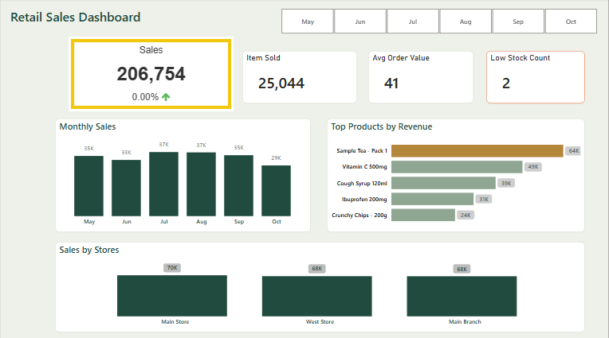
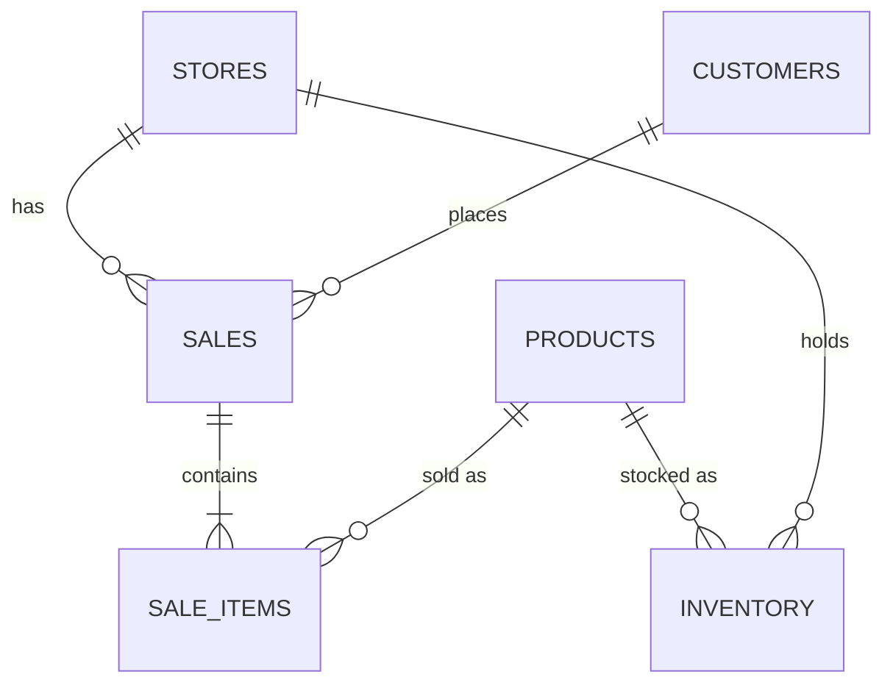

# 🛍️ Retail Store Sales Management – Oracle SQL + Power BI

## 📋 Project Overview
A **retail store system** built on Oracle SQL. It manages sales, products, stores, customers and inventory, enforces business rules with triggers, and exposes sales trends and slow-moving products through analytical views. A Power BI dashboard sits on top of the database.

The data is **synthetic** and was generated for learning and portfolio purposes.

---

## 📈 Power BI Dashboard


- **KPI cards:** total sales with a month-over-month change indicator, items sold, average order value, low-stock count
- **Visuals:** monthly sales, top products by revenue, sales by store
- **Interactivity:** month slicer
- **Model:** the Oracle tables are loaded through Power BI's Oracle connector, with a separate `Calendar` table for time intelligence

```DAX
Avg Order Value = AVERAGE(SALES[TOTAL_AMOUNT])

Low Stock Count =
CALCULATE(
    COUNTROWS(INVENTORY),
    FILTER(INVENTORY, INVENTORY[QUANTITY_IN_STOCK] <= RELATED(PRODUCTS[REORDER_LEVEL]))
)
```

---

## 🗂️ Repository Contents
| File | Purpose |
|------|---------|
| `create-table.sql` | Creates the tables |
| `create-sequences.sql` | Creates the sequences used for primary keys |
| `create_trigger.sql` | Auto-ID, pricing, stock and total-amount triggers |
| `test_triggers.sql` | Smoke test for the triggers (rolls back, changes no data) |
| `docs/dashboard.png` | Dashboard screenshot |

**Run order:** `create-table.sql` → `create-sequences.sql` → `create_trigger.sql` → load data → analytical views → `test_triggers.sql`

---

## 🧱 Database Schema



| Table | Columns |
|-------|---------|
| **PRODUCTS** | `PRODUCT_ID` (PK), `SKU` (unique), `NAME`, `CATEGORY`, `UNIT_PRICE`, `COST_PRICE`, `REORDER_LEVEL` |
| **STORES** | `STORE_ID` (PK), `NAME`, `CITY`, `ADDRESS` |
| **CUSTOMERS** | `CUSTOMER_ID` (PK), `NAME`, `PHONE`, `LOYALTY_MEMBER` |
| **SALES** | `SALE_ID` (PK), `STORE_ID` (FK), `CUSTOMER_ID` (FK), `SALE_DATE`, `TOTAL_AMOUNT` (maintained by trigger) |
| **SALE_ITEMS** | `SALE_ITEM_ID` (PK), `SALE_ID` (FK), `PRODUCT_ID` (FK), `QUANTITY`, `UNIT_PRICE`, `DISCOUNT` (%), `LINE_TOTAL` (maintained by trigger) |
| **INVENTORY** | `INVENTORY_ID` (PK), `PRODUCT_ID` (FK), `STORE_ID` (FK), `QUANTITY_IN_STOCK` |
| **SUPPLIERS** | `SUPPLIER_ID` (PK), `NAME`, `CONTACT_EMAIL`, `LEAD_TIME_DAYS` – reference data, not yet linked to products |

---

## ⚙️ Triggers

| Trigger | Fires on | What it does |
|---------|----------|--------------|
| `bi_products`, `trg_store_id`, `trg_customer_id`, `trg_sale_id`, `trg_sale_item_id`, `trg_inventory_id` | `BEFORE INSERT` | Fills primary keys from sequences |
| `trg_line_total` | `BEFORE INSERT/UPDATE` on `sale_items` | Calculates `quantity × unit price × (1 − discount%)`; uses the product price when no unit price is given |
| `trg_check_inventory` | `BEFORE INSERT` on `sale_items` | Blocks the sale when stock is insufficient or the product is not stocked in that store |
| `trg_update_inventory` | `AFTER INSERT/UPDATE/DELETE` on `sale_items` | Deducts stock on sale, adjusts on edit, restores on delete |
| `trg_update_sale_total` | `COMPOUND`, on `sale_items` | Recalculates `sales.total_amount` after each statement |
| `trg_no_negative_stock` | `BEFORE INSERT/UPDATE` on `inventory` | Rejects negative stock |

**Design note:** `trg_update_sale_total` is a compound trigger. A plain row-level trigger that reads `sale_items` while it is being modified fails with `ORA-04091` (mutating table). The compound trigger collects the affected sale ids row by row and recalculates each total once the statement completes.

Run `test_triggers.sql` to verify the behaviour – it inserts a sale, checks totals and stock, tests overselling and deletion, then rolls everything back.

---

## 📊 Analytical Views

### 🔹 1. Inventory Summary
```sql
CREATE MATERIALIZED VIEW mv_inventory_summary AS
SELECT i.store_id, s.name AS store_name,
       i.product_id, p.name AS product_name,
       i.quantity_in_stock
FROM inventory i
JOIN stores s   ON i.store_id = s.store_id
JOIN products p ON i.product_id = p.product_id;
```

### 🔹 2. Slow-Moving Products
```sql
-- Adjust the threshold to the sales volume of your data
CREATE MATERIALIZED VIEW mv_slow_moving AS
SELECT p.product_id, p.name AS product_name,
       SUM(si.quantity) AS total_sold
FROM sale_items si
JOIN products p ON si.product_id = p.product_id
GROUP BY p.product_id, p.name
HAVING SUM(si.quantity) < 5;
```

### 🔹 3. Sales Trend Over Time
```sql
CREATE VIEW v_sales_trend AS
SELECT TO_CHAR(s.sale_date, 'YYYY-MM') AS sale_month,
       SUM(s.total_amount) AS monthly_sales
FROM sales s
GROUP BY TO_CHAR(s.sale_date, 'YYYY-MM')
ORDER BY sale_month;
```

---

## 🚧 Future Work
- Link `SUPPLIERS` to `PRODUCTS` and add purchase orders
- RFM analysis by customer and by product
- Refresh strategy for the materialized views

---

## 🧑‍💻 Author
**Salma Ahmed Khogali**  
📍 Riyadh, Saudi Arabia  
📧 [saloomkhogali10@gmail.com](mailto:saloomkhogali10@gmail.com)  
💼 Bachelor's in IT – University of Khartoum  
🧠 Data Science Certified – Datamites Institute  
📜 Microsoft PL-300 – Power BI Data Analyst Associate
